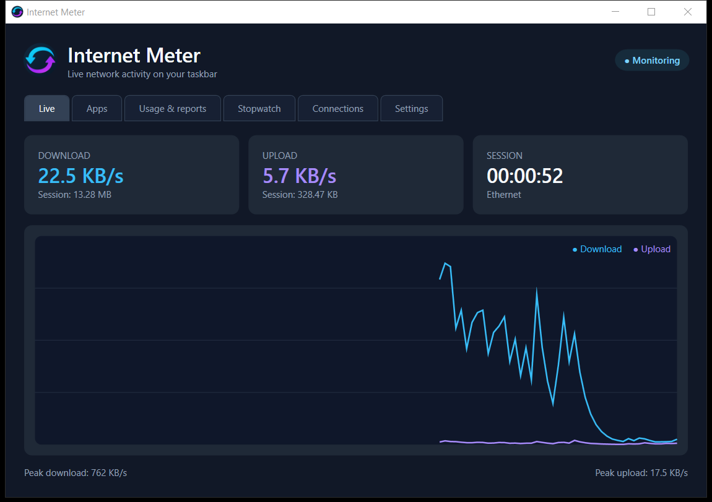

# Internet Meter

<p align="center">
  
</p>

Internet Meter is a lightweight Windows network monitor inspired by the workflow of DU Meter. It shows current download and upload throughput, keeps local usage history, and provides a dashboard for graphs, reports, alerts, per-app traffic, a transfer stopwatch, and connection inspection.



## Highlights

- Live download and upload rates from Windows network-interface byte counters.
- Native Windows 10 Explorer deskband embedded in the taskbar.
- Live graph with current, peak, session, and stopwatch statistics.
- Per-process TCP and UDP traffic monitoring.
- SQLite-backed daily usage history and CSV export.
- Monthly quota and sustained-speed notifications.
- Adapter selection, including optional VPN and virtual adapters.
- Owning-process TCP connection viewer.
- Configurable refresh interval, smoothing, units, colors, opacity, width, and layout.
- Start-with-Windows support, tray controls, single-instance protection, and local logs.
- No telemetry, account, cloud service, or packet-content inspection.

## Platform support

Internet Meter targets Windows 10/11 x64.

| Feature | Windows 10 | Windows 11 |
| --- | --- | --- |
| Dashboard and notification-area controls | Supported | Supported |
| Usage history, alerts, stopwatch, and connection viewer | Supported | Supported |
| Embedded taskbar toolbar | Supported on the classic taskbar | Not supported by the stock taskbar |

Windows 11 removed Explorer's classic Toolbars/deskband host. Internet Meter intentionally does not replace it with a floating overlay, so the dashboard and tray application continue to work but the embedded meter is unavailable on the stock Windows 11 taskbar.

## Build and run

### Requirements

- Windows 10 or Windows 11, x64
- [.NET 8 SDK](https://dotnet.microsoft.com/download/dotnet/8.0)
- An x64 MinGW-w64 `g++` compiler for the Windows 10 deskband
- PowerShell 5.1 or later
- Optional: Inno Setup 6 or later to create the installer

The native build script automatically checks these compiler locations before searching `PATH`:

- `C:\Program Files\CodeBlocks\MinGW\bin\g++.exe`
- `C:\msys64\mingw64\bin\g++.exe`

### Clone and test

```powershell
git clone https://github.com/musharaf-hossain-cs/Internet-Meter.git
cd Internet-Meter
dotnet restore InternetMeter.sln
dotnet test InternetMeter.sln -c Release
```

Building the managed application also builds the native deskband:

```powershell
dotnet build InternetMeter.sln -c Release
```

Run the development build with:

```powershell
dotnet run --project src\InternetMeter\InternetMeter.csproj -c Release
```

### Create distributable packages

Run the repeatable packaging script:

```powershell
.\scripts\build.ps1 -Configuration Release
```

It restores dependencies, runs the tests, publishes a self-contained x64 build, creates a ZIP archive and SHA-256 checksums, and builds the installer when Inno Setup is available. Generated files are written under `artifacts/` and are intentionally not committed.

## First run

The main application runs with normal user permissions. Closing the dashboard keeps monitoring active; use the notification icon's **Exit** command to stop it.

On Windows 10, right-click an empty area of the taskbar, open **Toolbars**, and select **Internet Meter**. If the entry does not appear after installation, restart Windows Explorer or sign out and back in once.

Opening the **Apps** tab starts a small elevated capture helper after a UAC prompt because Windows restricts real-time per-process network events. The helper exits with Internet Meter. Declining the prompt disables only per-app traffic monitoring.

Command-line options:

- `--background` starts without opening the dashboard.
- `--portable` stores `settings.json` and `usage.db` in a `Data` folder beside the executable.

Normal mode stores settings, usage history, and diagnostic logs in `%LOCALAPPDATA%\Internet Meter`.

For detailed operation and troubleshooting, see the [user guide](docs/USER_GUIDE.md).

## Project layout

- `src/InternetMeter` — WPF application, monitoring engine, persistence, and shared taskbar data publisher.
- `src/InternetMeter.Deskband.Native` — native x64 Windows 10 Explorer deskband/COM toolbar.
- `src/Shared` — protocol shared by the app and taskbar integration.
- `tests/InternetMeter.Tests` — xUnit tests for monitoring, formatting, per-app traffic, and persistence.
- `installer/InternetMeter.iss` — Inno Setup definition.
- `scripts/build-deskband.ps1` — native deskband build.
- `scripts/build.ps1` — restore, test, publish, archive, installer, and checksum pipeline.
- `docs/ARCHITECTURE.md` — design and data-flow notes.

## Privacy and measurement

The primary meter reads cumulative byte counters from the selected Windows network interfaces and calculates rates from monotonic elapsed time. It measures traffic handled by this computer, not the maximum capacity of the Internet connection. LAN transfers, VPN traffic, and operating-system traffic can be included depending on adapter selection.

The connection viewer reads Windows' TCP ownership table. The Apps tab reads Windows kernel network event metadata and aggregates byte counts by process ID. Internet Meter does not capture payloads, URLs, DNS queries, or packet contents, and it does not send usage data anywhere.

## Documentation

- [User guide](docs/USER_GUIDE.md)
- [Architecture](docs/ARCHITECTURE.md)
- [Contributing](CONTRIBUTING.md)
- [Security policy](SECURITY.md)

## License

No software license has been selected yet. Public availability of the source code does not grant permission to copy, modify, or redistribute it beyond rights provided by applicable law.
